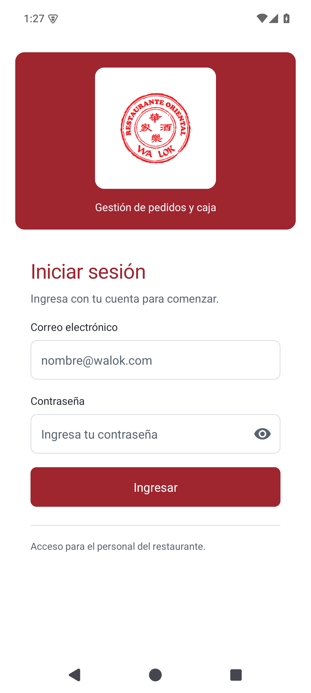
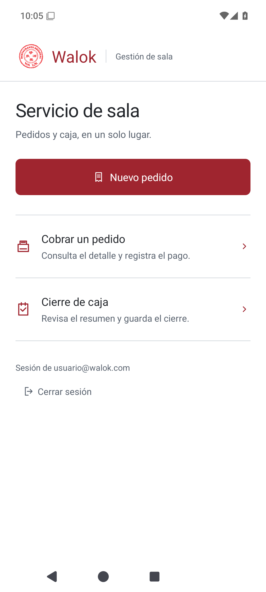
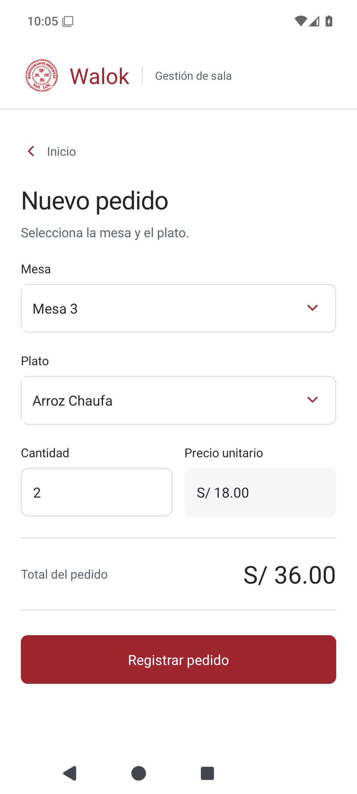

<p align="center">
  
</p>

<h1 align="center">Walok · Gestión de pedidos y caja</h1>

<p align="center">
  Una herramienta para la atención de sala en Android.<br>
  Java · Android Views · SQLite
</p>

<p align="center">
  <a href="#galería">Galería</a> ·
  <a href="#funcionalidades">Funcionalidades</a> ·
  <a href="#ejecución-local">Instalación</a>
</p>

## El proyecto

Walok acompaña el flujo de atención de un restaurante: registrar un pedido por mesa, consultar su importe en caja, guardar el pago y revisar el resumen antes del cierre.

Desarrollada como aplicación académica en **Java**, utiliza **Android Views y XML**, componentes de Material y una base local **SQLite**. Los datos se conservan en el dispositivo y la operación no requiere una API ni un servidor de base de datos.

## Operación de sala

Las cinco pantallas comparten navegación, etiquetas y una identidad visual basada en el logo del restaurante:

- **Acceso:** inicio de sesión con cuentas locales y entrada al menú de operaciones.
- **Pedidos:** selección de mesa, plato y cantidad, con cálculo del importe antes de registrar.
- **Caja:** consulta del detalle y del estado del pedido antes de guardar su pago.
- **Cierre:** revisión del responsable, la fecha y los importes; el resumen se guarda al confirmar.

El catálogo incluido contiene **cinco mesas y cuatro platos**: Arroz Chaufa, Pollo con Verduras, Tallarín Saltado y Kam Lu Wantán. Los nombres y precios están centralizados en los recursos de la aplicación.

## Galería

Capturas de Walok en ejecución con datos de demostración. Haz clic para abrirlas completas.

<table width="100%">
  <tr>
    <th colspan="3" align="center">Inicio de sesión</th>
    <th colspan="3" align="center">Operaciones</th>
  </tr>
  <tr>
    <td colspan="3" align="center" valign="top">
      <a href="./recursos/login.png"></a>
    </td>
    <td colspan="3" align="center" valign="top">
      <a href="./recursos/main.png"></a>
    </td>
  </tr>
  <tr>
    <th colspan="2" align="center">Pedidos</th>
    <th colspan="2" align="center">Caja</th>
    <th colspan="2" align="center">Cierre de caja</th>
  </tr>
  <tr>
    <td colspan="2" align="center" valign="top">
      <a href="./recursos/pedidos.png"></a>
    </td>
    <td colspan="2" align="center" valign="top">
      <a href="./recursos/caja.png"></a>
    </td>
    <td colspan="2" align="center" valign="top">
      <a href="./recursos/cierre_de_caja.png"></a>
    </td>
  </tr>
</table>

## Funcionalidades

| Módulo | Operaciones |
| --- | --- |
| Acceso | Validación contra usuarios locales y conservación de la sesión en `SharedPreferences`. |
| Inicio | Acceso a pedidos, cobro y cierre, además de salida de la sesión. |
| Pedidos | Registro de mesa, plato y cantidad; validación de cantidades entre 1 y 999; cálculo del importe según el catálogo. |
| Caja | Búsqueda por identificador, consulta de mesa y plato, comprobación del estado y registro del pago. |
| Cierre | Consulta del responsable, fecha, cantidad de pedidos e importe acumulado; confirmación antes de guardar y finalizar la sesión. |

Abrir de nuevo la pantalla de pedidos conserva los registros existentes. Al cambiar el identificador de búsqueda en caja, el detalle anterior deja de estar disponible para cobrar. Un pedido ya pagado no vuelve a habilitar el registro del pago desde la interfaz.

## Tecnologías

| Componente | Herramientas |
| --- | --- |
| Lenguaje | Java, con compatibilidad de código fuente Java 11. |
| Interfaz | Android Views / XML, AppCompat, Material Components y ConstraintLayout. |
| Persistencia | SQLite mediante `SQLiteOpenHelper`. |
| Sesión | `SharedPreferences`. |
| Construcción | Gradle Wrapper 8.11.1 y Android Gradle Plugin 8.10.0. |
| Plataforma | Android 7.0 o posterior (`minSdk 24`); compilación y destino API 35. |
| Pruebas | JUnit, AndroidJUnitRunner y Espresso. |

## Ejecución local

### Requisitos

- Android Studio y JDK 17 para compilar.
- Android SDK 35 y sus herramientas de construcción.
- Un emulador o dispositivo con Android 7.0 o posterior.

### Preparar y ejecutar

```powershell
git clone https://github.com/wilberbecerra/Chifa-Walok-App.git
cd Chifa-Walok-App
.\gradlew.bat assembleDebug
```

En Android Studio, abre la carpeta del proyecto, sincroniza Gradle, selecciona un dispositivo y ejecuta el módulo `app`.

El APK de prueba se genera en `app/build/outputs/apk/debug/app-debug.apk`. Con un dispositivo de pruebas conectado y `adb` disponible, puede instalarse mediante:

```powershell
adb install -r app/build/outputs/apk/debug/app-debug.apk
```

La opción `-r` actualiza una instalación existente conservando los datos de la aplicación. `JAVA_HOME` debe apuntar al JDK cuando se utilice Gradle desde la terminal; la ruta del SDK se configura localmente en Android Studio.

### Acceso local

Las cuentas iniciales de demostración están definidas en `UserDatabaseHelper`. Se crean al inicializar una base nueva. Los datos del dispositivo se conservan al actualizar la app; no es necesario restablecerlos para aplicar cambios de presentación.

## Base de datos local

La base **`WaLokUsers.db`** se crea automáticamente mediante `SQLiteOpenHelper` cuando la aplicación accede a ella por primera vez. No se distribuye un archivo `.db` precargado ni se necesita importar un script SQL.

| Tabla | Contenido |
| --- | --- |
| `users` | Cuentas locales de demostración. |
| `pedidos` | Mesa, plato, cantidad, precio unitario e importe total. |
| `pagos` | Identificador del pedido e importe del pago registrado. |
| `cierres` | Responsable, fecha, cantidad de pedidos e importe del resumen. |

La base puede inspeccionarse desde **App Inspection → Database Inspector** con la aplicación ejecutándose en un dispositivo compatible.

## Estructura

```text
app/src/main/
├── java/com/example/walok_app/
│   ├── MainActivity.java        # Acceso
│   ├── Menu.java                # Navegación entre módulos
│   ├── Pedido.java              # Registro e importe del pedido
│   ├── Caja.java                # Consulta y registro del pago
│   ├── CierreCaja.java          # Resumen y confirmación del cierre
│   ├── WalokActivity.java       # Presentación y navegación compartidas
│   └── UserDatabaseHelper.java  # Creación y acceso a SQLite
└── res/
    ├── layout/                  # Pantallas y componentes
    ├── drawable/                # Logo, iconos y superficies
    └── values/                  # Textos, catálogo, colores y estilos
app/src/androidTest/             # Flujos instrumentados
recursos/                        # Logo y capturas de la aplicación
```

## Pruebas y validación

```powershell
.\gradlew.bat testDebugUnitTest lintDebug
.\gradlew.bat connectedDebugAndroidTest "-Pandroid.testInstrumentationRunnerArguments.class=com.example.walok_app.WalokFlowTest"
```

Las pruebas instrumentadas deben ejecutarse en un emulador de pruebas. Los dos escenarios de `WalokFlowTest` comprueban el acceso, la validación de cantidades, la persistencia al reabrir pedidos, el registro del pago y el cierre con confirmación. Eliminan únicamente los registros que crean y restauran la sesión previa al terminar.

La aplicación se ha compilado y comprobado en Android 15 (API 35), incluido el acceso con teclado y desplazamiento en una pantalla de 320 dp de ancho. Las capturas de la galería proceden de la aplicación nativa en ejecución.

## Alcance académico

Walok es una aplicación demostrativa de operación local. El registro de pagos no integra una pasarela ni métodos de pago diferenciados. El resumen de cierre suma los pedidos almacenados, incluidos los pendientes: no representa exclusivamente dinero cobrado ni un corte por turno. No incluye sincronización entre dispositivos, gestión de inventario ni emisión de comprobantes fiscales.

El acceso utiliza cuentas de demostración; su implementación no constituye un sistema de autenticación para producción.
