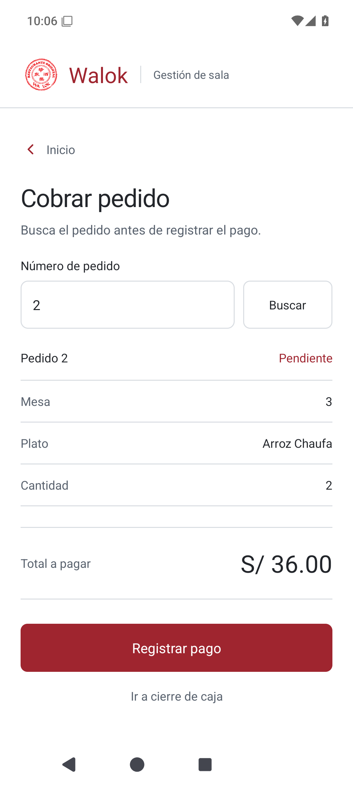
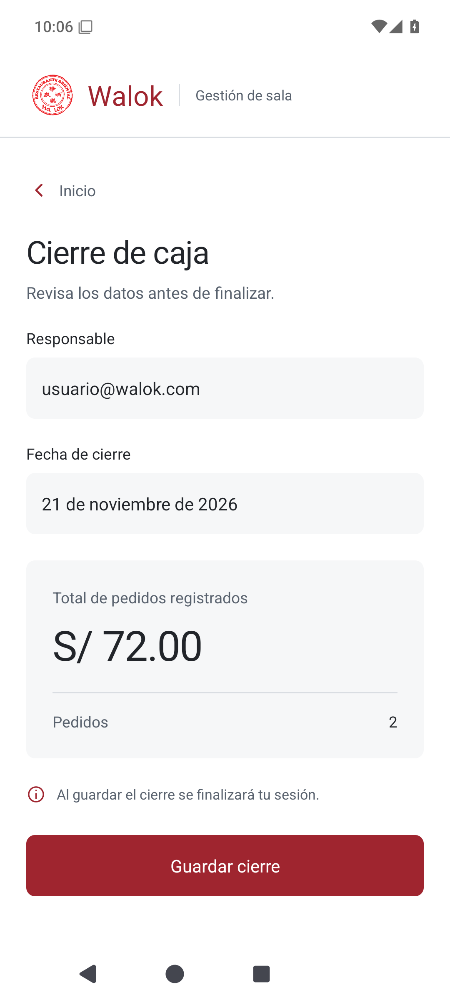

<div align="center">
  
  <h1>Walok</h1>
  <p>Gestión de pedidos y caja para Android</p>
</div>

## El proyecto

Aplicación Android para apoyar la atención de sala en el restaurante Chifa-Walok. Permite registrar pedidos por mesa, consultar su importe, guardar pagos y generar un resumen de cierre de caja.

Desarrollada en **Java**, con vistas **XML** y persistencia local en **SQLite**. Los datos se almacenan en el dispositivo; el proyecto no requiere una API ni un servidor de base de datos.

## Funcionalidades

| Módulo | Función |
| :--- | :--- |
| Acceso | Inicio de sesión con usuarios locales y conservación del correo del usuario en `SharedPreferences`. |
| Inicio | Navegación hacia pedidos, cobro, cierre de caja y salida de la sesión. |
| Pedidos | Registro de mesa, plato y cantidad, con cálculo del importe según el precio del catálogo. |
| Caja | Búsqueda de pedidos por identificador, consulta del detalle y registro del pago. |
| Cierre | Resumen de pedidos e importes, asociado a un responsable y una fecha. |

El catálogo incluido contiene cinco mesas y cuatro platos: Arroz Chaufa, Pollo con Verduras, Tallarín Saltado y Kam Lu Wantán. Los platos y precios están definidos en los recursos de la aplicación.

## Tecnologías

| Componente | Tecnología |
| :--- | :--- |
| Lenguaje | Java, con compatibilidad de código fuente Java 11 |
| Interfaz | Android Views / XML, AppCompat, Material Components y ConstraintLayout |
| Persistencia | SQLite mediante `SQLiteOpenHelper` |
| Sesión | `SharedPreferences` |
| Compilación | Gradle 8.11.1 y Android Gradle Plugin 8.10.0 |
| Plataforma | Android 7.0 o posterior (`minSdk 24`); compilación y destino API 35 |

## Flujo de uso

1. Iniciar sesión con una cuenta local.
2. Seleccionar la mesa, el plato y la cantidad para registrar un pedido.
3. Buscar el pedido desde caja y registrar su pago.
4. Revisar el responsable, la fecha y el resumen de pedidos antes de guardar el cierre.

## Base de datos local

La base se llama **`WaLokUsers.db`**. `UserDatabaseHelper` la crea junto con sus tablas cuando se abre por primera vez desde la aplicación; no se distribuye un archivo `.db` precargado ni se necesita importar un script SQL.

| Tabla | Datos principales |
| :--- | :--- |
| `users` | Identificador, correo y contraseña de las cuentas locales de demostración. |
| `pedidos` | Mesa, plato, cantidad, precio unitario e importe total. |
| `pagos` | Identificador del pedido e importe del pago. |
| `cierres` | Responsable, fecha, cantidad de pedidos e importe registrado. |

Puede inspeccionarse desde **App Inspection → Database Inspector** en Android Studio con la aplicación ejecutándose en un dispositivo compatible.

## Ejecución local

Requisitos: Android Studio, un JDK compatible con Android Gradle Plugin 8.10.0, Android SDK 35 y un emulador o dispositivo con Android 7.0 o posterior.

```powershell
git clone https://github.com/wilberbecerra/Chifa-Walok.git
cd Chifa-Walok
.\gradlew.bat assembleDebug
```

También puede abrirse la carpeta del proyecto en Android Studio, sincronizar Gradle y ejecutar el módulo `app`.

Las cuentas iniciales de demostración se definen en `UserDatabaseHelper`. Se crean al inicializar una base nueva en el dispositivo.

## Galería

### Acceso y navegación

| Acceso | Inicio |
| :---: | :---: |
|  |  |
| Acceso con una cuenta local. | Entrada a los módulos de operación. |

### Pedidos y cobro

| Registro de pedido | Caja |
| :---: | :---: |
|  |  |
| Selección de mesa, plato y cantidad. | Consulta del pedido y registro de su pago. |

### Cierre de caja

<p align="center">
  
</p>

Registro del responsable, la fecha y el resumen de pedidos.

## Alcance

Proyecto demostrativo de operación local. El registro de pagos no integra una pasarela ni métodos de pago diferenciados. El resumen de cierre corresponde a pedidos registrados y no constituye un comprobante fiscal. No incluye sincronización entre dispositivos ni gestión de inventario.
